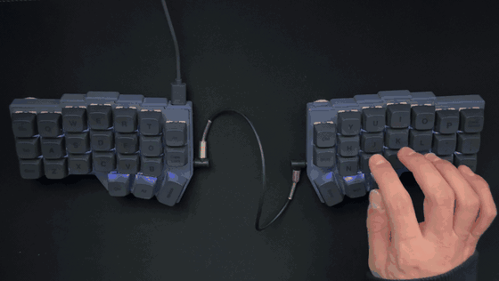

# Corne v4 para macOS

[](https://github.com/kats76/corne-mac/actions/workflows/build.yml)

[Read in English](README.md)

Layout de Vial pensado para macOS y firmware con **color por capa** para el **Corne v4.1 standard** de foostan (46 teclas, RP2040).

- `layouts/corne-mac.vil`: layout para Mac. Se carga en Vial con **File > Load saved layout**.
- `layouts/corne-windows.vil`: layout original de Windows, como backup.
- `keymap/mac_layers/`: firmware Vial oficial de foostan más el indicador de capa.
- Firmware compilado: descarga `corne-v4.1-mac-layers.uf2` desde [Releases](../../releases/latest).

## ¿Para qué placa es?

| Placa | Layout (`.vil`) | Firmware (`.uf2`) |
| --- | --- | --- |
| Corne v4.1 standard (46 teclas, RP2040) | Probado | Probado |
| Corne v4.0 standard (46 teclas, RP2040) | Debería funcionar, sin probar | `corne-v4.0-mac-layers.uf2` en Releases, sin probar |
| Corne v4 mini (42 teclas) | No: tiene otra cantidad de teclas | No |
| Corne v3 y anteriores (Pro Micro, AVR) | No | No: otro microcontrolador |

El layout solo depende de Vial, así que lo puede cargar cualquier placa con el firmware Vial de foostan y el layout de 46 teclas `LAYOUT_split_3x6_3_ex2`. El firmware, en cambio, se compila para una revisión exacta de la placa.

### Cómo identificar tu placa

La v4.0 y la v4.1 comparten el mismo ID de producto USB (`0x4653:0x0004`). Las distingue la versión del dispositivo: **4.10 es v4.1 y 4.00 es v4.0**.

- **macOS:** `ioreg -r -c IOHIDDevice -l | grep -A40 '"Product" = "Corne v4"' | grep VersionNumber` muestra `1040` (0x0410) en una v4.1.
- **Windows:** Administrador de dispositivos, el dispositivo Corne v4, Propiedades, Detalles, Id. de hardware. Busca `REV_0410` (v4.1) o `REV_0400` (v4.0).
- **Linux:** `lsusb -v -d 4653:0004 | grep bcdDevice` muestra `4.10` en una v4.1.

## El layout para Mac

Modificadores y capas en los pulgares: una mano sostiene la capa y la otra escribe. Cmd ocupa el pulgar que en Windows es Ctrl, así Cmd+C/V se presiona con el mismo dedo que ya tienes memorizado.


- **Esc**: Esc al tocar, Ctrl al mantener (terminal, tmux, vim).
- **Shot area**: captura de una región al portapapeles (Ctrl+Shift+Cmd+4) con una sola tecla.
- **Spotlight**: Cmd+Espacio en su propia tecla, porque Cmd y Espacio están en el mismo pulgar.
- **Line start / Line end**: Cmd+Izquierda y Cmd+Derecha. En Mac, Home y End desplazan el documento.
- **Capa Num + Nav**: modificadores sueltos en la fila central izquierda, para seleccionar por palabras con Shift+Opt+Derecha sin retorcer la mano.

### Layout original de Windows

<details>
<summary>Ver las capas de Windows</summary>


</details>

## Color por capa

Todo el teclado cambia de color según la capa activa, así siempre sabes dónde estás:



| Capa | Color |
| --- | --- |
| 0 Base | Blanco tenue (el color elegido en Vial) |
| 1 Num + Nav | Azul |
| 2 Símbolos | Verde |
| 3 Fn + Media | Rojo |
| 4 (sin usar) | Amarillo |
| 5 (sin usar) | Violeta |

El color corresponde al **número** de capa, no a su contenido. Si tu propio layout pone los símbolos en la capa 1, se verán en azul.

### Cambiar los colores

- **Capa base, sin compilar:** elige un color en la pestaña **Lighting** de Vial, o usa las teclas de tono y saturación de la capa Fn + Media. La base se mantiene a un tercio del brillo para que las demás capas resalten.
- **Capas 1 a 5:** edita las líneas `LAYER_n_COLOR` en `keymap/mac_layers/config.h`, compila y flashea. Los nombres de colores disponibles están justo encima de esas líneas.

Las teclas de brillo y la de encendido funcionan en todas las capas. Las teclas de efecto (modo) no tienen efecto visible, porque el color de la capa se pinta encima del efecto.

El firmware conserva el UID de Vial de foostan, así que los `.vil` siguen cargando. `SPLIT_LAYER_STATE_ENABLE` envía la capa activa a la mitad secundaria para que las dos se pinten igual.

## Compilar

Solo necesitas Docker. El toolchain de QMK nunca se instala en tu sistema: todo corre en la imagen oficial `ghcr.io/qmk/qmk_cli`, sin red. vial-qmk está fijado a un commit concreto, así todos compilan el mismo código fuente. El `.uf2` resultante no es idéntico byte a byte entre máquinas (la compilación incluye datos del entorno), pero funciona igual.

Docker tiene que estar en ejecución antes de compilar: abre primero Docker Desktop, o el script se detiene con `Cannot connect to the Docker daemon`.

```bash
./scripts/build.sh
```

La primera compilación descarga vial-qmk (unos cientos de MB) y la imagen de QMK, así que tarda unos minutos; el script muestra cada paso y el progreso de la descarga. Las siguientes reutilizan las dos.

El firmware queda en `dist/crkbd_rev4_1_standard_mac_layers.uf2`. Si al final aparece `cannot create regular file '/qmk_userspace/...'`, no pasa nada: la imagen intenta copiar el archivo a una carpeta que este proyecto no usa. El CI lo compila en cada push y lo adjunta a la release de cada tag `v*`. Para otra revisión: `KEYBOARD=crkbd/rev4_0/standard ./scripts/build.sh`.

### Compilar en Windows

Usa WSL 2 (por ejemplo, Ubuntu) con la integración de Docker Desktop para WSL, o Docker Engine instalado dentro de WSL. Si tienes Docker Desktop, ya tienes WSL 2.

1. Abre una terminal de WSL y clona el repo dentro de tu carpeta de Linux (`cd ~`), no en `/mnt/c/...`. Compilar desde el sistema de archivos de Windows es mucho más lento, porque QMK lee miles de archivos.
2. Ejecuta `./scripts/build.sh` como se indica arriba.
3. Copia el `.uf2` a Windows desde el Explorador de archivos, en `\\wsl$\<distro>\home\<usuario>\...`, o ejecuta `explorer.exe dist`.

Git Bash no está soportado: no trae `rsync` y reescribe las rutas que se pasan a Docker.

## Antes de flashear

- **Primero comprueba la revisión de tu placa** (ver arriba). La v4.0 y la v4.1 conectan las mitades de forma distinta, así que con el firmware equivocado las mitades pueden dejar de comunicarse.
- **Haz un backup de tu layout actual:** en Vial, **File > Save current layout**. Flashear con bootmagic lo borra.
- **Ten a mano el firmware de fábrica** por si quieres volver atrás: foostan lo publica en [foostan/kbd_firmware](https://github.com/foostan/kbd_firmware).
- El bootloader del RP2040 está en ROM, así que el microcontrolador no se puede brickear. Pero si un firmware equivocado hace que las teclas dejen de responder, el bootmagic tampoco funciona y necesitas el acceso de arranque por hardware de la placa para recuperarla. Consulta la guía de montaje de foostan para tu revisión.

## Flashear

El Corne v4.1 no tiene botón de reset. Se usa bootmagic, que además borra la memoria del teclado.

1. Desconecta el USB y después el cable jack (TRRS) entre las mitades.
2. Mitad izquierda: mantén presionada la **Q** y conecta el USB. Aparece el disco `RPI-RP2`; copia ahí el `.uf2`.
3. Desconecta el USB. Mitad derecha: mantén presionada la **P** y conecta el USB. Copia el mismo `.uf2`.
4. Con el USB desconectado, vuelve a conectar el cable jack. Conecta el USB en la mitad izquierda.
5. En Vial: **File > Load saved layout** y elige `layouts/corne-mac.vil`.

**Nunca conectes ni desconectes el cable jack con el USB conectado:** puede dañar el microcontrolador.

## Arma tu propio layout

1. Haz un fork de este repo y carga `layouts/corne-mac.vil` en Vial.
2. Cambia lo que quieras; Vial lo escribe en el teclado en tiempo real.
3. Expórtalo con **File > Save current layout** sobre `layouts/corne-mac.vil`.
4. Ejecuta `./scripts/draw.sh` para regenerar las imágenes de las capas.
5. Abre un pull request si lo quieres compartir.

Para cambiar los colores de las capas, consulta [Cambiar los colores](#cambiar-los-colores).

## Glosario

| Español | Inglés |
| --- | --- |
| capa | layer |
| mantener (una tecla) | hold |
| tocar (una tecla) | tap |
| flashear | flash |
| mitad secundaria | secondary half |
| código fuente fijado | pinned source |

## Créditos y licencia

Basado en el firmware Vial de foostan, de [foostan/kbd_firmware](https://github.com/foostan/kbd_firmware), y en [vial-qmk](https://github.com/vial-kb/vial-qmk). Las imágenes de las capas se generan con [keymap-drawer](https://github.com/caksoylar/keymap-drawer).

Licencia [GPL-2.0-or-later](LICENSE), igual que los proyectos de los que deriva.
