# Corne v4 for macOS

[](https://github.com/kats76/corne-mac/actions/workflows/build.yml)

[Leer en español](README.es.md)

A Vial layout designed for macOS plus a firmware with a **per-layer RGB indicator** for the foostan **Corne v4.1 standard** (46 keys, RP2040).

- `layouts/corne-mac.vil`: the Mac layout. Load it in Vial with **File > Load saved layout**.
- `layouts/corne-windows.vil`: the original Windows layout, kept as a backup.
- `keymap/mac_layers/`: foostan's official Vial firmware plus the layer color indicator.
- Prebuilt firmware: download `corne-v4.1-mac-layers.uf2` from [Releases](../../releases/latest).

## Which board is this for?

| Board | Layout (`.vil`) | Firmware (`.uf2`) |
| --- | --- | --- |
| Corne v4.1 standard (46 keys, RP2040) | Tested | Tested |
| Corne v4.0 standard (46 keys, RP2040) | Should work, untested | `corne-v4.0-mac-layers.uf2` in Releases, untested |
| Corne v4 mini (42 keys) | No: different number of keys | No |
| Corne v3 and older (Pro Micro, AVR) | No | No: different microcontroller |

The layout only depends on Vial, so any board running foostan's Vial firmware with the 46-key `LAYOUT_split_3x6_3_ex2` can load it. The firmware is built for one exact board revision.

### Identify your board

v4.0 and v4.1 share the same USB product ID (`0x4653:0x0004`). The device version tells them apart: **4.10 is v4.1, 4.00 is v4.0**.

- **macOS:** `ioreg -r -c IOHIDDevice -l | grep -A40 '"Product" = "Corne v4"' | grep VersionNumber` prints `1040` (0x0410) on a v4.1.
- **Windows:** Device Manager, the Corne v4 device, Properties, Details, Hardware Ids. Look for `REV_0410` (v4.1) or `REV_0400` (v4.0).
- **Linux:** `lsusb -v -d 4653:0004 | grep bcdDevice` prints `4.10` on a v4.1.

## The Mac layout

Modifiers and layers live on the thumbs: one hand holds the layer, the other one types. Cmd sits on the thumb that is Ctrl on Windows, so Cmd+C/V uses the same finger your muscle memory expects.



- **Esc**: Esc on tap, Ctrl on hold (terminal, tmux, vim).
- **Shot area**: screenshot of an area to the clipboard (Ctrl+Shift+Cmd+4) with a single key.
- **Spotlight**: Cmd+Space on its own key, since Cmd and Space share the left thumb.
- **Line start / Line end**: Cmd+Left and Cmd+Right. On a Mac, Home and End scroll the document instead.
- **Num + Nav layer**: plain modifiers on the left home row, so Shift+Opt+Right selects word by word without twisting your hand.

### Original Windows layout

<details>
<summary>Show the Windows layers</summary>



</details>

## Layer colors

The whole keyboard changes color with the active layer, so you always know where you are:

| Layer | Color |
| --- | --- |
| 0 Base | Dim white |
| 1 Num + Nav | Blue |
| 2 Symbols | Green |
| 3 Fn + Media | Red |

The firmware keeps foostan's Vial UID, so any `.vil` keeps loading. `SPLIT_LAYER_STATE_ENABLE` sends the active layer to the secondary half so both halves light up the same.

## Build

You only need Docker. The QMK toolchain is never installed on your system: everything runs in the official `ghcr.io/qmk/qmk_cli` image with networking disabled. vial-qmk is pinned to a fixed commit, so everyone builds the same source. The resulting `.uf2` is not byte-for-byte identical across machines (the build embeds environment details), but it behaves the same.

```bash
./scripts/build.sh
```

The firmware ends up in `dist/crkbd_rev4_1_standard_mac_layers.uf2`. A `cannot create regular file '/qmk_userspace/...'` message near the end is harmless: the image tries to copy the file to a folder that this project does not use. CI builds it on every push and attaches it to each `v*` tag release. For another revision, run `KEYBOARD=crkbd/rev4_0/standard ./scripts/build.sh`.

On Windows, run the scripts from WSL or Git Bash with Docker Desktop.

## Before you flash

- **Check your board revision first** (see above). v4.0 and v4.1 wire the link between halves differently, so the wrong firmware can leave the halves unable to talk to each other.
- **Back up your current layout:** in Vial, **File > Save current layout**. Flashing with bootmagic wipes it.
- **Keep the stock firmware at hand** in case you want to go back: foostan publishes it in [foostan/kbd_firmware](https://github.com/foostan/kbd_firmware).
- The RP2040 bootloader lives in ROM, so the controller cannot be bricked. But if a wrong firmware stops the keys from working, bootmagic stops working too, and you need the board's hardware boot access to recover. Check foostan's build guide for your revision.

## Flash

The Corne v4.1 has no reset button. Use bootmagic instead, which also wipes the keyboard memory.

1. Unplug the USB cable, then the TRRS cable between the halves.
2. Left half: hold **Q** and plug in the USB cable. A drive called `RPI-RP2` appears; copy the `.uf2` onto it.
3. Unplug the USB cable. Right half: hold **P** and plug in the USB cable. Copy the same `.uf2`.
4. With USB unplugged, reconnect the TRRS cable. Plug USB into the left half.
5. In Vial: **File > Load saved layout** and pick `layouts/corne-mac.vil`.

**Never plug or unplug the TRRS cable while USB is connected:** it can damage the microcontroller.

## Make your own layout

1. Fork this repo and load `layouts/corne-mac.vil` in Vial.
2. Change whatever you want; Vial writes it to the keyboard in real time.
3. Export with **File > Save current layout** over `layouts/corne-mac.vil`.
4. Run `./scripts/draw.sh` to regenerate the layer images.
5. Open a pull request if you want to share it.

To change the layer colors, edit `rgb_matrix_indicators_advanced_user` in `keymap/mac_layers/keymap.c` and rebuild.

## Credits and license

Based on foostan's Vial firmware from [foostan/kbd_firmware](https://github.com/foostan/kbd_firmware) and on [vial-qmk](https://github.com/vial-kb/vial-qmk). Layer images are generated with [keymap-drawer](https://github.com/caksoylar/keymap-drawer).

Licensed under [GPL-2.0-or-later](LICENSE), like the projects it derives from.
